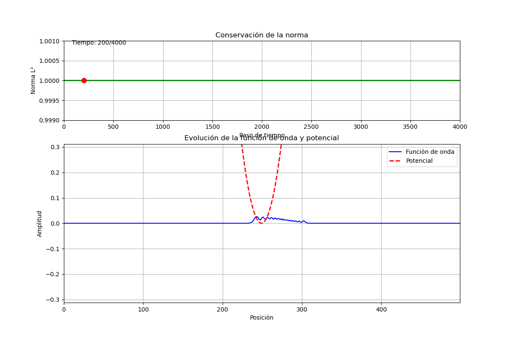
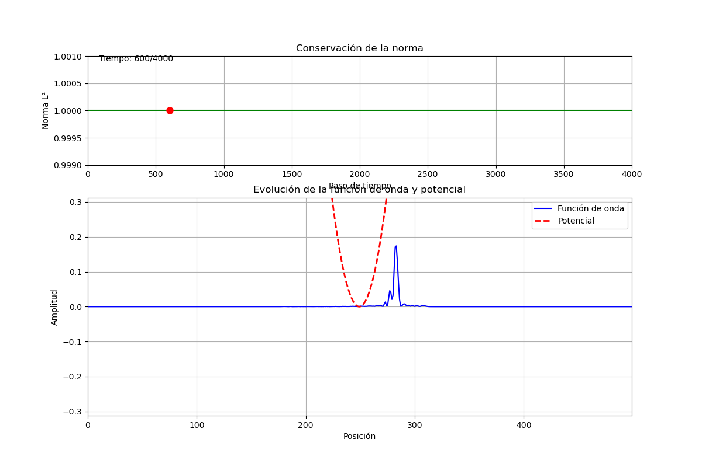
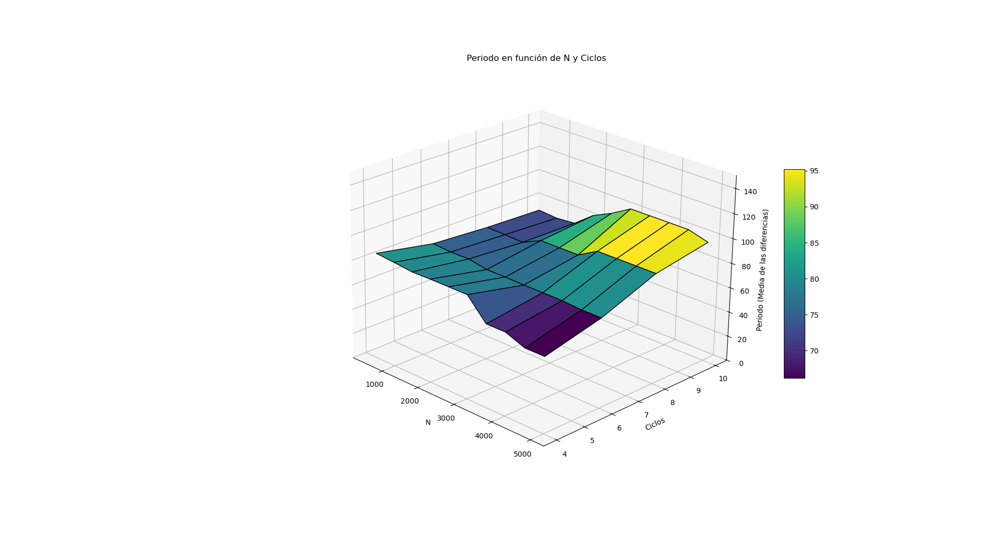

# Time-Dependent Schrödinger Equation (TDSE 1D) Solver
### Unitary Crank-Nicolson Scheme, Tridiagonal Thomas Inversion & OpenMP Parallelization in Fortran 95 and Python

[](https://fortran-lang.org/)
[](https://www.openmp.org/)
[](https://www.python.org/)
[](LICENSE)
[]()

---

## Overview

This repository implements a high-precision numerical solver for the **1D Time-Dependent Schrödinger Equation (TDSE)** governing the quantum dynamics of a wave packet in arbitrary potentials (harmonic oscillator, square well, tunneling barriers).

Standard explicit numerical schemes (such as FTCS) are unconditionally unstable for the Schrödinger equation. Fully implicit schemes, while stable, violate the fundamental unitarity of quantum mechanics, causing continuous artificial dissipation of probability.

Here, we employ the **implicit Crank-Nicolson method**, corresponding to the Cayley form of the time-evolution operator. This guarantees **unconditional stability** and **exact unitarity** (strict norm conservation $\int |\Phi|^2 dx = 1$) to machine precision. The resulting complex tridiagonal linear systems are inverted in $\mathcal{O}(N)$ linear time via the **Thomas algorithm**. Multi-grid parameter sweeps are accelerated across multi-core CPUs using **OpenMP**.

---

## Wave Packet Dynamics & Results

| Wave Packet Propagation in Potential Well | Quantum Autocorrelation & Period Analysis |
| :---: | :---: |
|   |  |
| *Evolution of $|\Phi(x,t)|^2$ colliding with potential barrier ($t=200, 600$)* | *Autocorrelation peak identification and period scaling* |

---

## Theoretical Foundations

### 1. The 1D Time-Dependent Schrödinger Equation
For a particle of mass $m$ in a static potential $V(x)$:

$$i\hbar \frac{\partial \Phi(x, t)}{\partial t} = \hat{H}\Phi(x, t) = \left[ -\frac{\hbar^2}{2m}\frac{\partial^2}{\partial x^2} + V(x) \right]\Phi(x, t)$$

The formal solution across time step $\Delta t$ is mediated by the unitary evolution operator:
$$\Phi(x, t + \Delta t) = e^{-i\hat{H}\Delta t / \hbar} \, \Phi(x, t)$$

### 2. Crank-Nicolson Discretization & Cayley Transform
To avoid truncation of the exponential that would destroy unitarity, the time evolution operator is approximated by the **Cayley transform**:

$$e^{-i\hat{H}\Delta t / \hbar} \approx \frac{1 - \frac{i \Delta t}{2\hbar}\hat{H}}{1 + \frac{i \Delta t}{2\hbar}\hat{H}} + \mathcal{O}(\Delta t^3)$$

Multiplying through yields:
$$\left(1 + \frac{i \Delta t}{2\hbar}\hat{H}\right) \Phi(x, t+\Delta t) = \left(1 - \frac{i \Delta t}{2\hbar}\hat{H}\right) \Phi(x, t)$$

Because the Cayley transform of any Hermitian operator $\hat{H}$ is strictly unitary:
$$\hat{U}^\dagger \hat{U} = \mathbf{I} \implies \int_{-\infty}^{\infty} |\Phi(x, t)|^2 \, dx = 1 \quad \forall t$$
Probability is rigorously conserved for all time steps $\Delta t$ without numerical dissipation.

### 3. Spatial Discretization & Tridiagonal Thomas Inversion
Discretizing space onto a uniform grid $x_j = j \Delta x$ ($j = 1, \dots, N$) with central finite differences for $\partial^2 / \partial x^2$ yields the linear system:

$$A \, \vec{\Phi}^{n+1} = B \, \vec{\Phi}^n$$

where $A$ and $B$ are complex tridiagonal matrices with diagonal elements $d_j = 2 + 2i\frac{\Delta x^2}{\Delta t} + V_j \Delta x^2$ and off-diagonal elements $-1$.

We invert $A$ in **$\mathcal{O}(N)$ operations** using the Thomas algorithm (tridiagonal Gaussian elimination) via backward recurrence coefficients $\alpha_j, \beta_j$:
$$\Phi_j^{n+1} = \alpha_j \Phi_{j+1}^{n+1} + \beta_j$$

### 4. Quantum Autocorrelation Function
To study wave packet revival and compare quantum oscillatory periods with classical harmonic motion ($T = 2\pi / \omega$), we compute the autocorrelation function:

$$C(t) = \langle \Phi(0) | \Phi(t) \rangle = \int_{-\infty}^{\infty} \Phi^*(x, 0) \, \Phi(x, t) \, dx$$

Peaks in $|C(t)|^2$ reveal exact revival times and energetic eigenstate superpositions.

---

## Repository Structure

```
.
├── schr.f95               # Core 1D TDSE solver with Crank-Nicolson & Thomas algorithm
├── schr2.f95              # Alternative boundary condition implementation
├── armonico.f95           # Quantum harmonic oscillator simulation kernel
├── armonico2.f95          # High-resolution harmonic oscillator dynamics
├── multArmonico.f95       # Automated multi-parameter batch solver
├── multi/                 # OpenMP parallel grid studies & period analysis
│   ├── multOpen.f95       # Multi-threaded OpenMP solver across (N, n_ciclos)
│   ├── analizarPeriodo.py # Harmonic period extraction from autocorrelation peaks
│   ├── analizarPicos.py   # Peak detection algorithm for C(t)
│   ├── filtradoPicos.py   # Signal filtering & Fourier smoothing
│   ├── periodoFinal.png   # Final period convergence plot
│   ├── graficas/          # Autocorrelation curves across parameter combinations
│   └── grafPicos/         # Peak detection diagnostics
├── representar.py         # Matplotlib animated visualization of |Phi(x,t)|^2 and V(x)
├── representar2.py        # High-resolution phase and probability visualizer
├── repCorrelacion.py      # Autocorrelation function |C(t)|^2 plotting script
├── repPotencial.py        # Potential landscape renderer
├── grafOnda/              # Wave packet evolution frame snapshots
├── docs/                  # Academic documentation & theoretical slides
│   └── schr-SLIDES_v2.pdf # Presentation slides & mathematical monograph
├── Makefile               # Build system for Fortran binaries & OpenMP targets
├── requirements.txt       # Python visualization dependencies
└── LICENSE                # MIT License
```

---

## Quickstart & Execution

### 1. Prerequisites
- **Fortran Compiler**: `gfortran` with OpenMP support.
- **Python**: 3.10+ with `numpy`, `scipy`, and `matplotlib`.

Install Python packages:
```bash
pip install -r requirements.txt
```

### 2. Compile and Run the Quantum Solver
Compile with `-O3` optimization:
```bash
make
./schr
```
This generates the initial wave packet, evolves $\Phi(x,t)$ through the potential, and outputs `norma.dat`, `potencial.dat`, and `correlacion.dat`.

### 3. OpenMP Parallel Parameter Sweep
To run the multi-threaded parameter grid search across multiple values of $N$ and cycle counts:
```bash
make parallel
./multi/multOpen
```
Then extract harmonic periods and plot convergence:
```bash
python3 multi/analizarPeriodo.py
```

### 4. Wave Packet Visualization
To launch the interactive animation of wave packet propagation and norm conservation:
```bash
make plot
# or: python3 representar.py
```

---

## Key Results & Verification

1. **Norm Conservation**: The discrete norm $\sum_j |\Phi_j(t)|^2 \Delta x$ remains equal to $1.0000000000$ with absolute deviation $< 10^{-12}$ over thousands of time steps.
2. **Classical-Quantum Correspondence**: In the harmonic potential $V(x) = \frac{1}{2}m\omega^2 x^2$, the packet oscillates with period matching classical Ehrenfest expectation $T = 2\pi/\omega$.
3. **Tunneling & Reflection**: When incident on a finite rectangular barrier with energy $E < V_0$, the packet splits smoothly into reflected and transmitted probability components according to quantum tunneling amplitudes.

---

## Author & License

Developed by **[Pablo Orellana Chornyak](https://github.com/porellanaphysics)**  
- 🎓 *M.Sc. Student in Space Science and Technology*, Universidad de Alcalá (UAH, Alcalá de Henares).  
- 🎓 *B.Sc. in Physics (Graduado en Física)*, Universidad de Granada (UGR).  
- 📬 **Email**: [pablo.orellana.physics@gmail.com](mailto:pablo.orellana.physics@gmail.com) | **LinkedIn**: [linkedin.com/in/p-orellana](https://linkedin.com/in/p-orellana)  

Licensed under the [MIT License](LICENSE).

